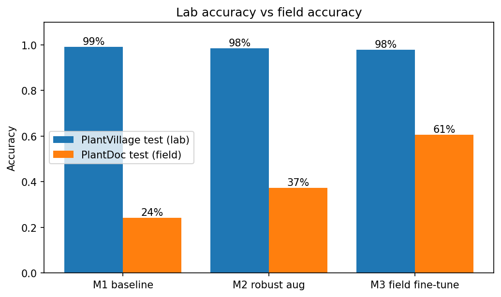
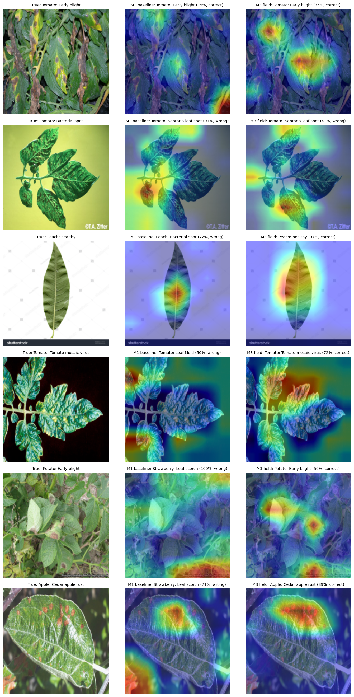

# Field-Ready Plant Disease Detection

Plant disease classifiers trained on **PlantVillage** score 97-99%, but PlantVillage photos are single leaves on plain lab backgrounds. Farmers take photos in the field: several leaves, soil, shadows, blur. This project **measures how much accuracy is lost on real field photos** (the PlantDoc dataset) and **reduces that gap** with field-like augmentation and fine-tuning, then explains predictions with Grad-CAM and exports a phone-sized TFLite model.

**Stack:** Python, TensorFlow / Keras 3, EfficientNetV2-B0, tf.data, scikit-learn, Grad-CAM, TFLite, Gradio



---

## Results

Evaluated on the PlantVillage test split (lab photos) and the PlantDoc test split (field photos). The PlantDoc test split is never used for training or model selection.

| Model | PlantVillage test acc (lab) | PlantDoc test acc (field, 95% CI) | Field top-3 | Field macro-F1 |
|---|---|---|---|---|
| M1 baseline | **99.2%** | **24.1%** (19.1-30.0%) | 53.0% | 0.234 |
| M2 robust augmentation | 98.5% | 37.3% (31.4-43.6%) | 63.6% | 0.362 |
| M3 field fine-tune | 97.9% | **60.6%** (54.2-66.6%) | 85.6% | 0.603 |

PlantVillage test n = 5,431 images; PlantDoc test n = 236 images across 27 classes.

**What this shows**
- **The lab-to-field gap is huge:** a model at 99.2% on PlantVillage gets only 24.1% of real field photos right.
- **Field-like augmentation alone** lifts field accuracy to 37.3% without any field data.
- **Fine-tuning on ~2,000 field photos** lifts it to **60.6% (2.5x the baseline)**, with top-3 accuracy of 85.6%, while lab accuracy only drops from 99.2% to 97.9%.
- The confidence intervals of M1 and M3 do not overlap, so the improvement is not noise from the small test set.
- **Weakest field classes:** tomato bacterial spot (0 of 9), tomato leaf mold and potato late blight. Several tomato diseases look alike in field photos. See `results/report_plantdoc_final.txt`.

| Deployment (final model) | |
|---|---|
| TFLite size (int8 weights) | **6.7 MB** (Keras model: 24.8 MB, 3.7x smaller) |
| TFLite field accuracy | 60.6% (no loss from quantization) |
| Mean latency, 1 image (Kaggle CPU) | 34 ms |

**Grad-CAM, baseline vs field model** (where each model looked). On field photos the baseline often focuses on the background or soil (e.g. the potato row), while the field model focuses on the lesions:



---

## Approach

| Step | What | Why |
|---|---|---|
| Data | PlantVillage colour images (38 classes, 14 crops), stratified 80/10/10 split. PlantDoc field photos, each folder mapped to its PlantVillage class (unmatched folders are skipped and listed) | Lab data to train, field data to test what really matters |
| Model | EfficientNetV2-B0 (ImageNet weights), global average pooling, dropout, softmax head | ~6M parameters vs ~15M for the VGG16 base used in my first version; faster and phone-sized |
| Training | Stage 1: head only (lr 1e-3). Stage 2: unfreeze the top 40% of the base, BatchNorm frozen (lr 1e-4). Mixed precision on GPU | Standard transfer-learning recipe that avoids destroying pre-trained features |
| M2: field-like augmentation | Random crop/zoom, rotation, flips, shifts, brightness / contrast / saturation / hue jitter, a random occluding patch, sensor noise | Imitates what changes between a lab photo and a phone photo outdoors |
| M3: field fine-tune | M2 fine-tuned on a 50/50 mix of PlantVillage and PlantDoc *train* images (lr 3e-5); best epoch chosen on a PlantDoc validation split carved from train | Shows the model a little real field data without forgetting the lab classes |
| Evaluation | Accuracy with a 95% Wilson confidence interval, top-3 accuracy, macro-F1, per-class reports, confusion matrix | PlantDoc's test set is small, so the interval shows how certain each number is |
| Explainability | Grad-CAM on the last convolutional layer | Checks whether the model looks at disease spots or at the background |
| Deployment | TFLite with dynamic-range (int8 weight) quantization; accuracy and latency re-measured after conversion; Gradio demo | A model that could run on a farmer's phone, and a demo anyone can try |

---

## Run it

### Train and evaluate (Kaggle, free GPU)
1. Create a Kaggle notebook and upload `notebooks/field_ready_plant_disease.ipynb`.
2. **Add Input**: `abdallahalidev/plantvillage-dataset`.
3. **Settings**: Accelerator **GPU T4 x1** (or P100), **Internet ON** (PlantDoc is cloned from GitHub).
4. **Save Version -> Save & Run All (Commit)**. About 2-3 hours. Each model is saved as soon as it finishes, so a re-run skips finished stages.
5. Download `outputs.zip` from the Output tab: it contains `results/` (metrics, charts, reports) and `app/` (`model.keras`, `model.tflite`, `labels.json`).

### Demo (local)
```bash
cd app                   # model.keras, model.tflite and labels.json are included
pip install -r requirements.txt
python app.py            # http://127.0.0.1:7860
```

### Demo (Hugging Face Spaces, free)
New Space -> SDK **Gradio** -> upload `app.py`, `requirements.txt`, `model.keras`, `labels.json`.

---

## Project structure
```
notebooks/field_ready_plant_disease.ipynb   data, training (M1-M3), evaluation, Grad-CAM, TFLite export
app/app.py                                   Gradio demo with Grad-CAM overlay
app/requirements.txt
app/model.keras, model.tflite, labels.json   trained final model (M3)
results/                                     metrics.json, results table, charts, Grad-CAM, per-class reports
```

---

## Limitations
- **PlantDoc's test set is small**, so field accuracy has a wide confidence interval (reported in the table).
- Only PlantDoc classes with a PlantVillage equivalent are evaluated; the notebook prints which folders were skipped.
- PlantVillage contains several photos of the same leaf, so a random split can make lab accuracy look higher than it is. That is part of why the field test matters.
- Field photos often contain several leaves; the model predicts one label per image.
- There is no "not a leaf" class: a random or unrelated photo still gets one of the 38 labels (a random-noise test image was labelled with 61% confidence). An out-of-distribution check is a natural next step.
- A study project: predictions should be confirmed by an agriculture expert before treatment.

## History
The first version of this project (a college notebook) used a frozen VGG16 on the pre-augmented PlantVillage copy. In November 2026 I rebuilt it to address what that version could not answer: does it work outside the lab?

## References
- Hughes & Salathe (2015). *An open access repository of images on plant health* (PlantVillage).
- Singh et al. (2020). *PlantDoc: A Dataset for Visual Plant Disease Detection*. CoDS-COMAD.
- Tan & Le (2021). *EfficientNetV2: Smaller Models and Faster Training*. ICML.
- Selvaraju et al. (2017). *Grad-CAM: Visual Explanations from Deep Networks via Gradient-based Localization*. ICCV.

## License
MIT
